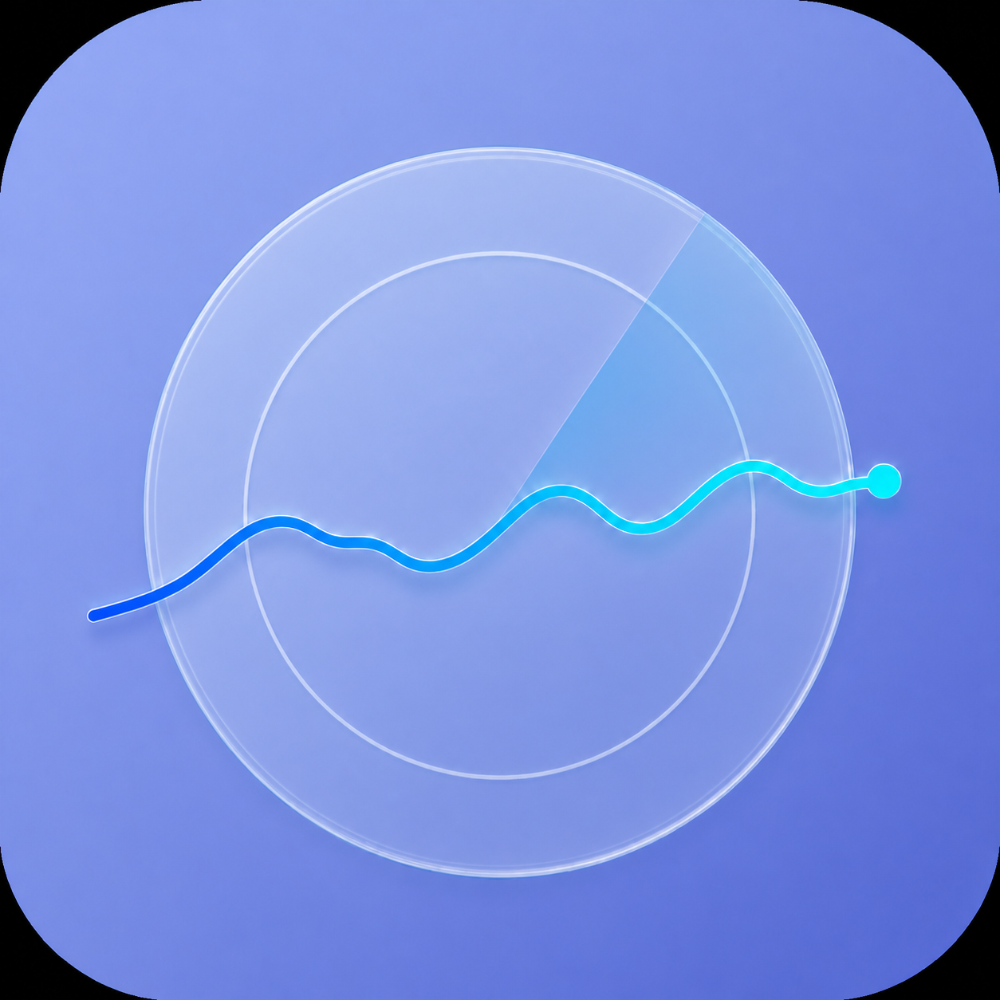
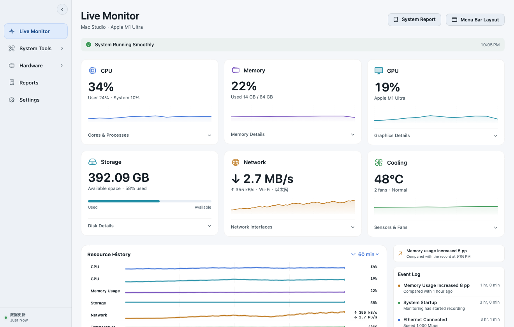
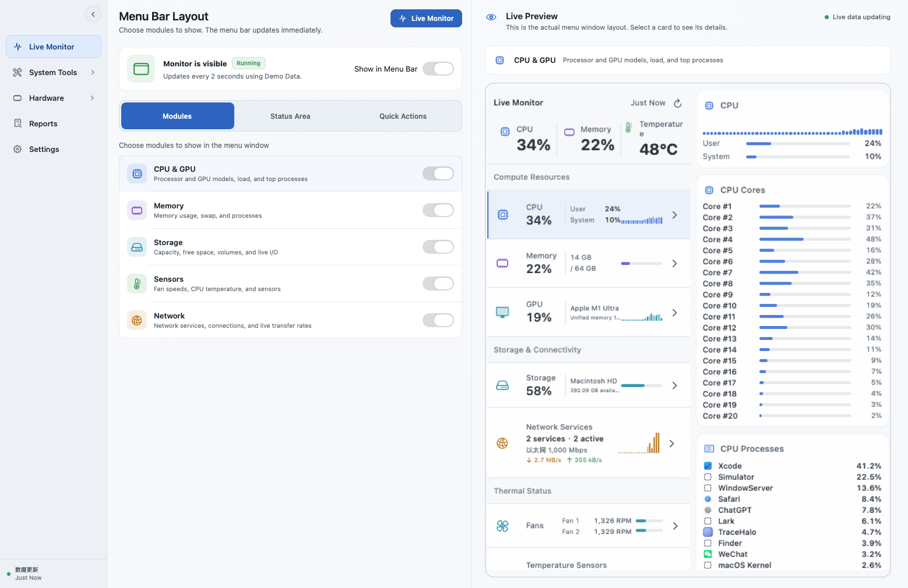
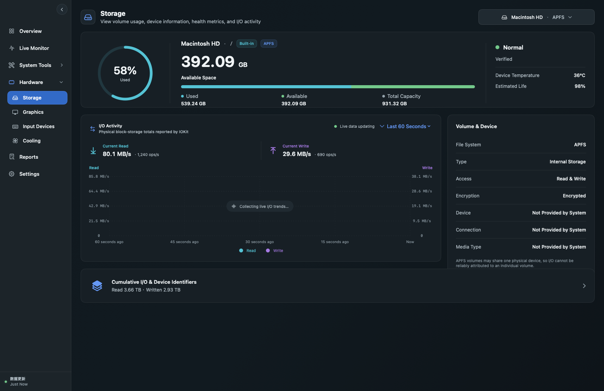
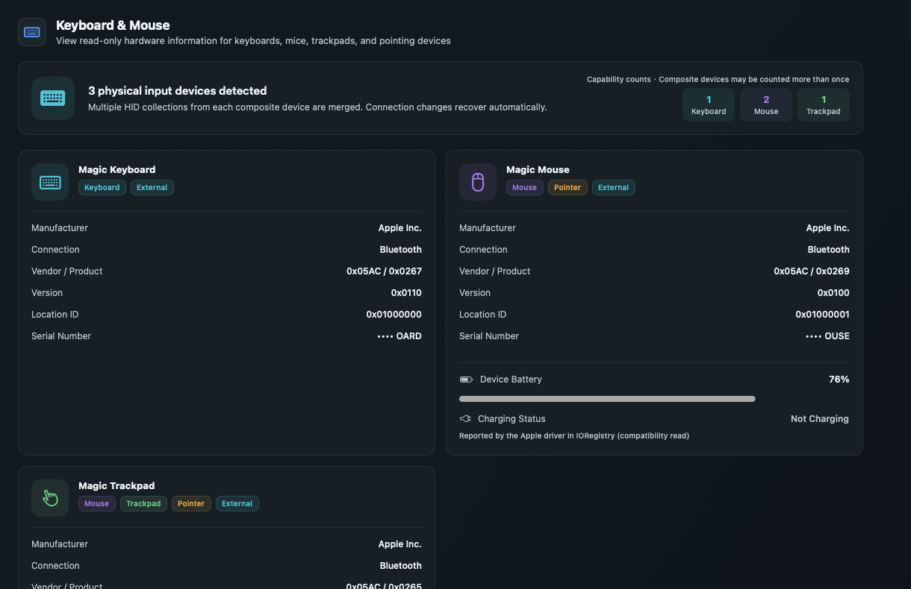
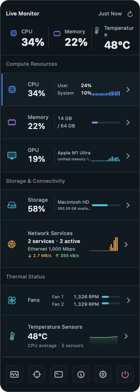

  

<h1 align="center">TraceHalo</h1>

  A free, open-source system monitor for Mac.

  
  
  
  

  <strong>English</strong> · <a href="README.zh-Hans.md">简体中文</a>

## v0.2.1 Beta

**v0.2.1 Beta (build 39)** improves application management, local-data review and first-run uninstall access setup, and fixes main-window startup and recovery. The locally installed candidate is ready for review; the public installer and Apple notarization are pending. [Upgrade notes in Simplified Chinese](docs/releases/v0.2.1.md)

## Your Mac, at a glance

TraceHalo brings system status and live readings into one home page. Select a resource card to expand its details in place, or keep a small live summary in the menu bar.

- See CPU, GPU, memory, storage, network, fan, and temperature activity
- Find busy CPU cores and high-usage processes
- Check storage space, disk activity, and available device health information
- Inspect displays, graphics, keyboards, mice, and trackpads
- View charge, charging state, cycles, and battery health on MacBooks
- Review app icons, versions, and disk usage, then choose what to keep when moving an app to the Trash
- Choose exactly what appears in the menu bar
- Switch between English and Simplified Chinese, light and dark appearance

When macOS or the hardware does not provide a value, TraceHalo shows it as unavailable. It does not invent a value.

TraceHalo does **not** clean disks, manage SSD TRIM, control fans, record keystrokes, or track pointer movement.

## See TraceHalo

### Monitor your Mac in one place

Live readings, resource trends, and expandable details share one home page.

### Configure the menu bar

Open **Menu Bar Layout** from **Live Monitor** to choose what appears in the menu bar and preview the result immediately.

### Check storage and disk activity

See available space, volume information, current read/write activity, and recent I/O history.

### Inspect connected input devices

Battery and charging information appears only when the device reports it to macOS.

### Open details from the menu bar

Closing the main window does not stop the menu bar monitor.

  

## Download and install

TraceHalo requires **macOS 14 or later**.

1. Open the [Releases page](https://github.com/ShawnShoper/TraceHalo/releases).
2. Choose a published release and download its `TraceHalo-<version>-arm64-x86_64.dmg` and matching `.sha256` file. Its ZIP and TAR.GZ archives contain the same verified app.
3. Verify the download using the distribution guide. When upgrading, use **Quit TraceHalo Completely** before replacing the app. Open the DMG, then drag **TraceHalo.app** into **Applications**. [Distribution Guide](DISTRIBUTION.md)
4. Open TraceHalo from the Applications folder.

The Releases page shows which versions have a public installer.

### If macOS says Apple cannot verify TraceHalo

Do not bypass the warning or disable macOS security. A current public Release must have a valid Developer ID signature, accepted Apple notarizations, independently verifiable tickets for the DMG and its embedded app, and a matching SHA-256 file. Confirm that the download came from the official Releases page and that its checksum matches, then report the affected filename and macOS version if the warning remains.

Maintainers can create local test packages with `make release-local`. The accompanying `release-manifest.txt` identifies them by `Signing mode: adhoc`.

## First-time setup

1. Open **Live Monitor** and select a resource card to see its details.
2. Open **Menu Bar Layout** from the top of **Live Monitor**, choose the modules you want, and enable the menu bar display.
3. Open **Settings** to choose the language, appearance, refresh interval, and temperature unit.
4. Open **Cooling**. If extra access is needed for fan or temperature readings, TraceHalo will explain the available read-only option.
5. Close the main window and use TraceHalo from the menu bar.

To stop TraceHalo completely, use **Quit TraceHalo Completely** or the power button at the bottom of the menu bar panel. Closing the window and `Command-Q` intentionally leave the menu bar monitor running.

## Common questions

<strong>Why can’t I see a fan or temperature?</strong>

Different Mac models expose different sensors. TraceHalo shows only data it can read reliably. On supported models, it can offer an optional read-only sensor service when normal access is unavailable.

<strong>Why is there no Battery page on my desktop Mac?</strong>

TraceHalo hides battery-only controls when no built-in battery is detected. It also avoids showing an estimated whole-machine input-power value when macOS does not provide a trustworthy reading.

<strong>Does TraceHalo record keyboard or mouse activity?</strong>

No. It reads device information only. It does not record keystrokes or track pointer movement.

<strong>Does TraceHalo upload my system information?</strong>

No telemetry upload is built into the app. Monitoring data stays on the Mac. Reports are exported only when you choose to save them and hide sensitive identifiers by default.

<strong>How do I change the language?</strong>

Open **Settings → Application Language**. The default follows macOS; unsupported system languages fall back to English. You can also select English or Simplified Chinese directly.

## Privacy and support

Normal monitoring is read-only. System changes require review and confirmation. App removal keeps local data by default. If you choose to clean up local data, only checked files are moved to the Trash. When TraceHalo recognizes a vendor uninstaller, it shows the vendor’s recommended entry point. On first launch, optional app-removal access setup is offered when needed. Reopen it in Settings → Uninstall Permissions. Ready installations avoid repeated trips to System Settings; system administrator verification and final removal confirmation remain in place. Discovery also considers signed components, app groups, package receipts and literal script paths. Select All includes shared/unconfirmed findings and saved content, with explicit ownership and cleanup-impact labels. A scrollable final confirmation lists the targets before anything moves. Discovery has scope and permission limits and cannot identify all historical data. See [data discovery and cleanup boundaries](docs/application-data-discovery.md).

When reporting a problem, include your Mac model, macOS version, the affected page, and whether the value is missing or incorrect. Do not post unredacted serial numbers, network addresses, personal file paths, or system reports.

For source builds and tests, see [Development Guide](DEVELOPMENT.md). For release signing and package verification, see [Distribution Guide](DISTRIBUTION.md). Contributions are described in [CONTRIBUTING.md](CONTRIBUTING.md).

## License

TraceHalo is licensed under the [Apache License 2.0](LICENSE).

TraceHalo is independently implemented and is not affiliated with, endorsed by, or based on the private source code of Sensei or Cindori.
